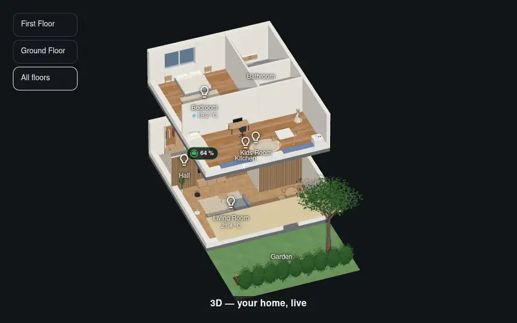
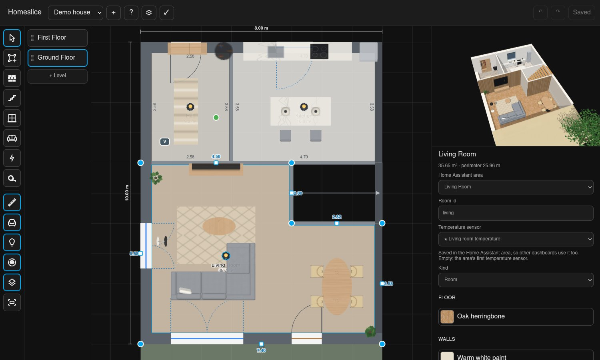

# Homeslice — 3D floor plan for Home Assistant

[](https://hacs.xyz/docs/faq/custom_repositories)
[](https://github.com/headtr1ck/homeslice/releases)
[](https://github.com/headtr1ck/homeslice/actions/workflows/ci.yml)
[](LICENSE)

**Your home as a live, interactive 3D house in Home Assistant.** Homeslice is a 3D floor
plan for Home Assistant: draw your floors and rooms in the built-in editor, and a Lovelace
card shows them as an exploded isometric house, a tilted plan or a 2D floor plan, with
lights, blinds, doors, climate, energy flows and people live on it. Free and open source
(MIT), installed with HACS, made for wall tablets.

▶️ **[Try the live demo](https://headtr1ck.github.io/homeslice/)** — the card and the editor in your browser, on a demo house (nothing to install, nothing is saved).



> [!WARNING]
> **Early alpha.** Homeslice changes quickly: the house format, the card's options and the
> editor may change between versions without migration, and there will be bugs. Keep a copy
> of your house (editor → ⚙ → *Download* YAML). Feedback and issues are very welcome.

## Why Homeslice

- **Built from your Home Assistant.** Levels are your HA floors, rooms are your HA areas,
  and their lights, blinds, sensors and devices are found by themselves. Rename an area and
  the house follows.
- **A full editor inside Home Assistant.** No drawing program, no SVG, no Blender: trace
  rooms over your floor plan image, walls appear by themselves, drag Home Assistant areas
  onto rooms, add doors, windows, stairs, roofs and furniture, with a live 3D preview.
  Imports from Sweet Home 3D, SVG floor plans and other 3D floor-plan cards.
- **Made for AI assistants.** The house is short, readable YAML with clear errors and a
  guide listing your real floors, areas and entities. Paste it into any chatbot with a
  photo of your floor plan, or let Home Assistant's own assistants, MCP clients and scripts
  read, check and save the house through Homeslice's LLM API.
- **Live state everywhere.** Lights glow in their colours, blinds and garage doors move,
  doors swing, a temperature/humidity/CO₂ heatmap, presence and alarms, animated solar,
  battery and grid flows, people and pets in their rooms, weather and the real sun.
- **Robots on the plan.** Robot vacuums and lawn mowers drive around with their live
  position and show what their dock needs; their map can be the floor plan you trace.
  Importing rooms straight from a robot's map is in progress.
- **3D, 2.5D and 2D from one house.** Exploded 3D, tilted plan, flat plan, all floors side
  by side; day, night, white model or blueprint look — switch per card, not per drawing.
- **400+ furniture pieces, plus whole libraries.** Built-in pieces resize sensibly and
  react (screens show what plays, fans turn); add Poly Haven models, Sketchfab models with
  your own account, or your own glTF files.
- **Made for wall tablets.** Draws only when something changes, a low-quality mode, kiosk
  options, time travel through the last day, a walk-through at eye level.
- **Private and free, for good.** Runs locally: no cloud, no telemetry, no account. No paid
  add-ons, no furniture packs to buy, no premium tier.
- **In seven languages:** English, German, French, Dutch, Spanish, Italian and Polish.



## Installation

### HACS (recommended)

[](https://my.home-assistant.io/redirect/hacs_repository/?owner=headtr1ck&repository=homeslice&category=integration)

1. Click the button above, or in HACS: *⋮ → Custom repositories*, add
   `https://github.com/headtr1ck/homeslice` with the type *Integration*.
2. Download **Homeslice** and restart Home Assistant.
3. Add the integration:

   [](https://my.home-assistant.io/redirect/config_flow_start/?domain=homeslice)

New versions show up under *Settings → Updates*; after updating, restart Home Assistant and
reload the browser. The card needs no extra dashboard resource.

### Manually

Download `homeslice.zip` from the [latest release](https://github.com/headtr1ck/homeslice/releases/latest),
unpack it into `<config>/custom_components/homeslice/` and restart Home Assistant.

## Quick start

1. Install Homeslice and add the integration under *Settings → Devices & services*.
2. Open **Homeslice** in the sidebar and create a house: pick its floors and give rough
   outside dimensions. Each floor starts with a room per area.
3. Shape the rooms (or trace them over your floor plan), add doors, windows and furniture,
   and save (`Ctrl+S`). Or let an [AI assistant](docs/llm.md) write the house for you.
4. Add a **Homeslice** card to a dashboard, turn the preview to the angle you like and pick
   a look.

## House format at a glance

A whole house can be this short; the editor writes the same format.

```yaml
schema: 1
id: home
name: Home
outline: { rect: [0, 0, 10, 8] }
levels:
  - id: ground
    floor_id: ground_floor          # a Home Assistant floor
    rooms:
      - { id: living, area_id: living_room, rect: [0, 0, 6, 8] }   # a Home Assistant area
      - { id: kitchen, area_id: kitchen, rect: [6, 0, 4, 8] }
    openings:
      - { room: living, side: south, at: 1, width: 2.4, cover: cover.living_room }
  - id: first
    floor_id: first_floor
    rooms:
      - { id: bedroom, area_id: bedroom, rect: [0, 0, 10, 8] }
```

## Documentation

- [**The card**](docs/card.md): looks, views and modes, every option, layers, rules,
  popups, overlays, energy, and the `show`/`announce` actions.
- [**The editor**](docs/editor.md): tools and shortcuts, drawing rooms and walls, assigning
  areas, roofs, finishes, the furniture library (Poly Haven, Sketchfab, uploads), backup and
  imports.
- [**The house format**](docs/yaml.md): the YAML reference with a full example.
- [**AI assistants**](docs/llm.md): a prompt for any chatbot, the LLM API for Home
  Assistant's assistants, MCP and the HTTP API.
- [**Robots**](docs/robots.md): robot vacuums and lawn mowers, live position and
  calibration, their maps.
- [**Development**](docs/development.md): building, tests, adding furniture, releases.

## Contributing

Issues with ideas, bugs and screenshots are as welcome as pull requests; see
[CONTRIBUTING.md](CONTRIBUTING.md). Help with more languages is welcome too: a new language
is two JSON files to translate.

## License and credits

MIT. Every feature and every built-in piece of furniture is in this repository.

Optional models and textures come from [Poly Haven](https://polyhaven.com) (CC0) and
[Sketchfab](https://sketchfab.com) (with your own account, keeping each model's author and
licence). Homeslice is not made or endorsed by Poly Haven or Sketchfab; see
[the editor docs](docs/editor.md#furniture-library) for details.
