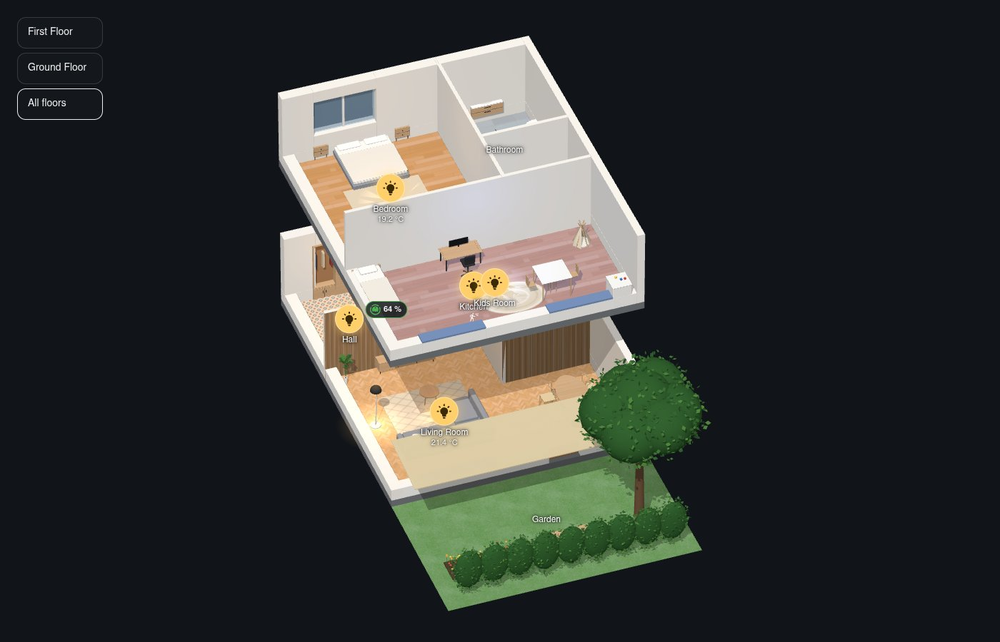
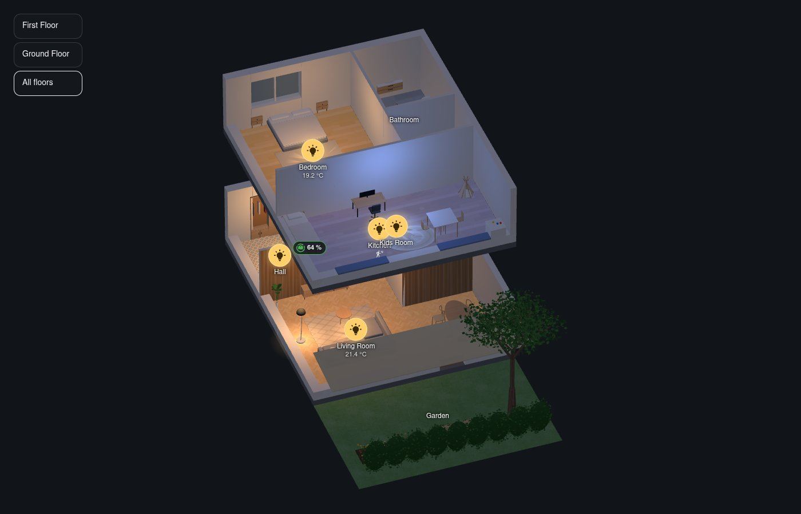
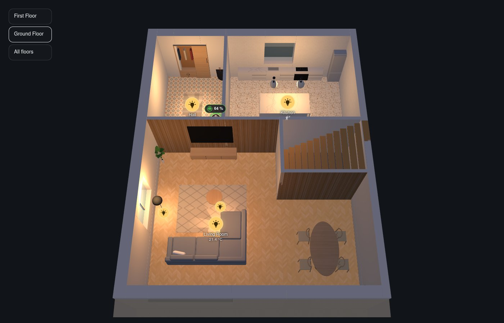
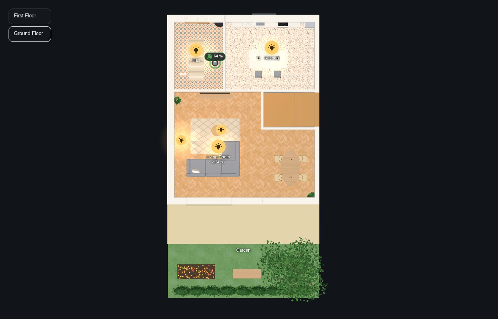
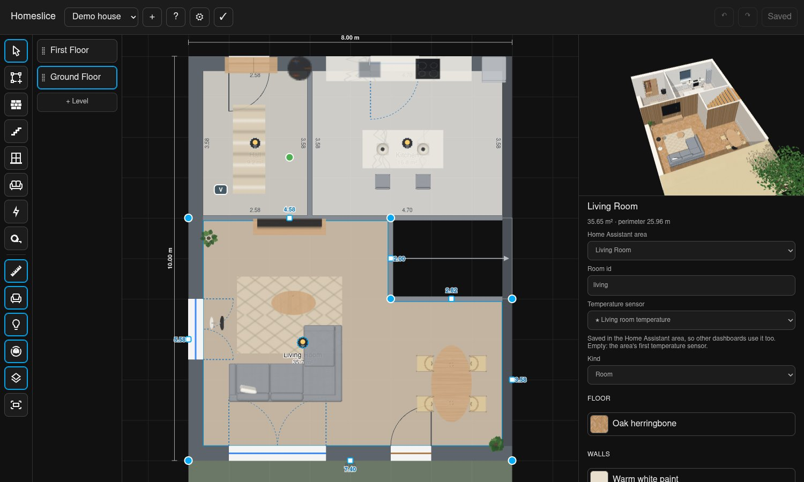

# Homeslice — 3D floor plan for Home Assistant

[](https://hacs.xyz/docs/faq/custom_repositories)
[](https://github.com/headtr1ck/homeslice/releases)
[](https://github.com/headtr1ck/homeslice/actions/workflows/ci.yml)
[](LICENSE)

> [!WARNING]
> **Early alpha.** Homeslice is young and changes quickly: the house format, the card's
> options and the editor may change between versions without migration, and there will be
> bugs. Keep a copy of your house (editor → ⚙ → *Download* YAML) and expect to adjust it
> after updates. Feedback and issues are very welcome.

**A 3D floor plan (floorplan) for Home Assistant.** Draw your home in the built-in floor plan editor —
floors, rooms, walls, doors, windows, furniture, garden — linked to Home Assistant's own
floors, areas and entities, and see it live on your dashboards as an interactive,
exploded isometric 3D house or a 2D floor plan: a Lovelace card that turns your home into a
digital twin, with lights, blinds, shutters, garage doors, climate, media players and
energy flows. Free and open source (MIT), installed with HACS, made for wall tablets.
**No paywall, no premium features: everything is free.** In English, German, French, Dutch,
Spanish, Italian and Polish (help with more languages is welcome).

| The card: your house in 3D | At night, with its lights on |
|---|---|
|  |  |
| **One floor on its own** (the others slide away) | **The 2D plan** (`mode: plan`) |
|  |  |



*The demo house (`npm run dev`); pictures made by `node scripts/showcase.mjs`.*

## Status

Alpha: card and editor work and are used daily on one house, but nothing is stable yet.

- **Card:** exploded 3D view with live lights (lamps light their rooms, more so at night;
  a linked lamp lights up itself), blinds, garage doors, doors and windows that open with their contacts, temperatures and
  awnings; linked devices show their state (TV screens, fires, fans and outdoor units
  turning, washers running, curtains); one
  floor on its own (the others slide away) and hover; tap a linked piece to switch it; on a lamp button drag up or down to dim, hold for details;
  room popups (a bottom sheet on phones); optional roof and energy overlay (solar,
  battery, grid and devices with animated power flows).
- **Editor** (admin sidebar page *Homeslice*): start a house from Home Assistant's floors
  and areas, trace rooms over a floor plan image, drag walls and corners with snapping,
  doors and windows with their blinds, stairs, lights and energy devices; undo/redo;
  the whole house as YAML in and out.

## Installation

### HACS (recommended)

[](https://my.home-assistant.io/redirect/hacs_repository/?owner=headtr1ck&repository=homeslice&category=integration)

1. Click the button above, or in HACS: *⋮ → Custom repositories*, add
   `https://github.com/headtr1ck/homeslice` with the type *Integration*.
2. Download **Homeslice** and restart Home Assistant.
3. Add the integration:

   [](https://my.home-assistant.io/redirect/config_flow_start/?domain=homeslice)

New versions show up under *Settings → Updates* like any other update; after updating,
restart Home Assistant and reload the browser. The card needs no extra dashboard resource:
the integration serves it.

### Manually

Download `homeslice.zip` from the [latest release](https://github.com/headtr1ck/homeslice/releases/latest),
unpack it into `<config>/custom_components/homeslice/` and restart Home Assistant. (The
repository itself doesn't contain the built frontend; build it with `npm run build`.)

## Getting started

1. Install Homeslice (above).
2. Add the **Homeslice** integration under *Settings → Devices & services*.
3. Open **Homeslice** in the sidebar and create a house: pick its floors, give rough outside
   dimensions, and each floor starts with a placeholder room per area.
   - **1. Rooms & walls:** drag rooms into shape, or upload the floor plan (level
     inspector), set its scale with two points of a known length, and draw rooms over
     it (`R`). Walls appear by themselves; a wall between two rooms can be dragged on its
     own or switched to *open* (e.g. an open kitchen). Stairs: `S`.
     Select a room to give its floor and walls a finish (wood, tiles, stone, paint,
     acoustic panels, brick…), one wall a different one, and the outline for the facade.
     Besides the built-in finishes, the picker offers Poly Haven's photo textures (CC0),
     which Home Assistant downloads once when you pick one.
   - **2. Doors & windows:** click a wall to add a window, link its blind and contact.
   - **3. Objects & entities:** lights are placed automatically and can be dragged;
     drag furniture from the library (wall pieces go against a wall; `R` to turn); place solar, battery, grid and power-measured
     devices for the energy overlay. The library has three sources: **Built-in** (pieces
     drawn by Homeslice to their size, with a finish and often a second colour: sofas,
     wardrobes, kitchens, bathroom, lamps, plants, garden, play, cars and bikes…), **Poly Haven** (realistic
     models, downloaded into Home Assistant once when placed) and **Custom** (upload your
     own `.glb`; it has to be self-contained: models that load textures or data from
     other websites are refused, so no screen showing your house contacts a stranger).
   - Save (`Ctrl+S`). Cards update at once.
4. Add a **Homeslice** card to a dashboard. Its visual editor shows a small preview: turn
   it into the angle you want, then pick the look.

Alternatively, write the house as YAML (format below): paste it in the editor's
*House settings*, or put it in `<config>/homeslice/<house>.yaml` and call the action
`homeslice.import_files` (files never overwrite a house edited in the editor unless
`force: true`). Broken links (deleted areas, floors, entities) show up under
*Settings → Repairs*.

## Setting up your home with an AI assistant

An assistant can draw the house from a photo or sketch of your floor plan. It needs the
format and your Home Assistant's floors, areas and devices; Homeslice provides both,
checks what the assistant wrote with the editor's rules, and keeps the previous version
so any save can be undone (editor → ⚙ → *Restore the version from …*).

- **Any chat assistant (ChatGPT, Claude, Gemini…):** editor → ⚙ → *Copy prompt for an AI
  assistant*. Paste it into the chat with your floor plan, paste the answer into
  *Replace the house with this YAML*, and if it has mistakes, *Copy errors for the
  assistant* gives them back to it.
- **Home Assistant's own assistant:** in a conversation agent's settings (OpenAI,
  Anthropic, Google, Ollama…), add the API **Homeslice** next to *Assist*. It gets four
  tools: `homeslice_get_guide`, `homeslice_get_house`, `homeslice_validate_house` and
  `homeslice_save_house` (saving needs an administrator).
- **External assistants (Claude Code, Claude Desktop, Cursor…):** add Home Assistant's
  **MCP Server** integration and pick the *Homeslice* API there; the assistant connects
  with a long-lived access token and gets the same tools.
- **Scripts and assistants without MCP:** the HTTP API, with a long-lived access token
  (`Authorization: Bearer …`):

  ```sh
  curl -H "Authorization: Bearer $TOKEN" http://homeassistant:8123/api/homeslice/guide            # the guide with your floors, areas, entities
  curl -H "Authorization: Bearer $TOKEN" http://homeassistant:8123/api/homeslice/houses/home      # the house as YAML
  curl -X POST --data-binary @home.yaml -H "Authorization: Bearer $TOKEN" http://homeassistant:8123/api/homeslice/validate
  curl -X PUT  --data-binary @home.yaml -H "Authorization: Bearer $TOKEN" http://homeassistant:8123/api/homeslice/houses/home   # admins
  curl -X POST -H "Authorization: Bearer $TOKEN" http://homeassistant:8123/api/homeslice/houses/home/restore                     # admins
  ```

The guide itself is [`custom_components/homeslice/guide.md`](custom_components/homeslice/guide.md).

**Coming from Sweet Home 3D?** Editor → ⚙ → *Import* → *From Sweet Home 3D (.sh3d)*: rooms, doors, windows and
furniture come in as YAML to check before using it.

## Card

```yaml
type: custom:homeslice-card
house: home                    # the house id
interactive: false             # true: drag to turn, scroll/pinch to zoom, double-click to reset;
                               #   buttons turn, show from above or tilted, and keep a start view on this device
energy: false                  # true: energy overlay (shows the roof unless view.roof: false)
mode: 3d                       # or plan: a drawn floor plan from above (dark walls, door swings),
                               #   or tilted: a plan at an angle with low walls; both one floor at a time
floors: one                    # plan only: all shows every floor at once, side by side
sun: true                      # light from the real sun (sun.sun), darker at night
look: day                      # or night (dark, glowing outlines), auto (night after sunset),
                               #   white (a white model) or blueprint (dark blue, glowing edges)
accent: "#4fc3f7"              # the night look's outline colour
presence: true                 # mark rooms with motion/occupancy/presence; leak, smoke and gas alarms always show
lux: false                     # true: rooms as bright as their lux sensor reads (dark rooms look dark), with the reading
quality: auto                  # low: for weak wall tablets (no shadows, plain colours, simple furniture); high; auto picks
heatmap: temperature           # optional: tint rooms by temperature (blue cold … red hot), humidity, carbon_dioxide or pm25
values: [temperature, humidity, carbon_dioxide]   # readings on the room labels (default: temperature), a dot when out of range
thresholds:                    # optional: own colour steps (labels and heatmap)
  carbon_dioxide: [{ value: 800, color: orange }, { value: 1200, color: red }]
follow: [event.doorbell, binary_sensor.front_door]   # turn to where these go active (a note says what), then back
follow_alarms: false           # true: also turn to leak, smoke and gas alarms
follow_seconds: 30             # how long to stay; nothing moves while someone uses the card
level: ground                  # optional: the floor shown first (plan: default the entrance floor)
view:                          # all optional
  azimuth: 250                 # overview camera: 0 north, 90 east, 180 south, 270 west
  elevation: 38                # degrees above the horizon
  projection: isometric        # or perspective
  explode: 2.6                 # gap between floors in metres
  roof: false                  # draw the roof in the overview
  furniture: detailed          # or simple: boxes instead of models
  cut_height: 0.4              # outer walls facing a low camera are cut to this height…
  cut_below: 60                # …while the camera is lower than this (degrees)
  show_outdoor: true           # garden, terrace etc. (drawn see-through)
  focus:                       # camera when a floor is picked
    azimuth: 180
    elevation: 65
    projection: perspective
  levels:                      # per-floor cameras, by level id
    ground: { elevation: 90, projection: isometric }
room_panel: true               # a tap on a room opens its panel (false: rooms do nothing)
lamp_style: icon               # lamp buttons: a glowing bulb (icon) or a bulb in a dark disc (circle)
idle_return: 120               # wall tablets: back to the start view after 2 minutes without a touch
night: "22:00-06:00"           # dim the card at night (or: sun), night_brightness: 0.4
idle_orbit: true               # turn the house slowly while nobody uses it
clock: true                    # a clock in the corner
buttons:                       # shortcuts in the bottom right: scenes/scripts run, lights and switches toggle
  - entity: scene.movie_night
  - entity: script.good_night
    name: Good night
  - entity: light.terrace
    level: ground              # only while this floor is picked
rain: binary_sensor.rain       # warn about open windows while it rains (default: the weather entity)
power_outage: binary_sensor.grid_down   # a warning on the card while it is on
heating: true                  # underfloor heating loops glow while they heat (rooms with underfloor:)
badges: true                   # notes above linked pieces: bin pickup today/tomorrow, thirsty plants, post, time left
actions:                       # optional: own tap/hold actions for linked pieces and lamps (Lovelace actions)
  light.hall:
    tap_action: { action: more-info }
    hold_action: { action: perform-action, perform_action: script.night_light }
popups:                        # optional, by room id or area id
  living_room:
    mode: extend               # or replace
    cards:
      - type: weather-forecast
        entity: weather.home
```

Tap a room's lamp to switch its lights (on a picked floor, rooms with several lamps get
one toggle per lamp), tap a room for a popup with its devices (including the blinds and
contacts of its windows), pick a floor to lift the floors above away. Hovering a floor
highlights it and makes the floors above see-through.

## House format (short form)

Metres; `x` points east, `y` points south (north is up, as on a printed plan). Levels are
listed bottom to top. Walls are generated from the rooms: you never draw them. Rooms are
stored on wall centre lines; outside walls grow inwards from the outline.

```yaml
schema: 1
id: home
name: Home
outline: { rect: [0, 0, 10, 8] }       # outer face of the exterior walls, shared by all levels
party_walls: [west]                     # walls shared with a neighbour
roof: { ridge: east_west, pitch: 35 }   # optional; drawn by cards with view.roof
north: 0                                # optional: degrees the plan's north side is turned east of true north
inverted_covers: [cover.awning]         # optional: covers that report open/closed the other way round
robots:                                 # optional: robot vacuums and lawn mowers
  - { entity: vacuum.robo, level: ground, dock: [0.8, 3.3] }   # live position: see the editor
opening_defaults:                       # optional, house-wide per opening type
  window: { sill: 0, height: 2.2 }      # e.g. floor-to-ceiling windows
facade_openings:                        # windows stacked on several floors, defined once
  - side: south
    at: 1                               # metres from the outline's west (or north) end
    width: 2.4
    levels: [ground, first]             # each lands in the room behind it on that floor
    covers: { ground: cover.living_room, first: cover.bedroom }
vertical:
  - id: stairs
    rect: [6, 3, 3, 1.2]
    from: ground
    to: first
    shape: straight                     # or u_turn (two flights joined by winders)
    up: east                            # direction the first flight climbs
    entry: 0                            # floor before the first step (stairs that start further in)
facade: brick_red                       # optional: the outside of the exterior walls
energy:                                 # optional, for the card's energy overlay
  - { kind: solar, roof: south }        # sensors default to HA's energy settings
  - { kind: battery, level: ground, at: [8.5, 1] }
  - { kind: grid, level: ground, at: [9, 1] }
  - { kind: device, power: sensor.heat_pump_power, level: ground, at: [9.5, 7.5] }
levels:
  - id: ground
    floor_id: ground_floor              # Home Assistant floor
    # include_floors: [outside]        # optional: areas of more HA floors on this level
    height: 2.6                         # optional storey height
    rooms:
      - id: living
        area_id: living_room            # Home Assistant area
        rect: [0, 0, 6, 8]              # x, y, width, depth (or polygon: [[x, y], …])
        floor: oak_herringbone          # optional finishes: floor, inside walls, one side
        wall: paint_sage
        wall_sides: { north: acoustic_oak }
        lights:                         # optional: the area's lights are placed automatically
          - { entity: light.reading_lamp, at: [1, 2] }   # metres from the room's north-west corner
          - { entity: light.downlights, type: spot, at: [1, 1], spots: [[2, 1], [3, 1]] }  # a row on one light
          - { entity: light.cove, type: strip, at: [0.2, 0.2], to: [4, 0.2], height: 2.4 }  # also: indirect
        cameras:                        # optional: what it sees, red while motion is on; a tap shows it
          - { entity: camera.hall, at: [0.3, 0.3], direction: 135, fov: 90, motion: binary_sensor.hall_motion }
        furniture:                      # optional; the editor's library shows every type
          - { type: sofa, at: [3, 6.5] }
          - { type: table, at: [3, 2], rotation: 90 }
          - { type: tv, at: [3, 7.8], rotation: 180, mount: wall, elevation: 1 }  # wall, ceiling
          - { type: sofa_corner, at: [2, 3], mirror: true }                    # flipped left to right
          - { type: sofa, at: [3, 4], model: polyhaven:Sofa_01, size: [1.57, 0.66], height: 0.8 }
          - { type: wardrobe, at: [5, 0.4], model: modern:wardrobe_sliding, finish: walnut, accent: black, size: [2, 0.65], height: 2.2 }
          # model: modern:<kind> | polyhaven:<id> | custom:<id> | builtin (default: the card's style)
      - { id: kitchen, area_id: kitchen, rect: [6, 0, 4, 8], floor: terrazzo, wall: tile_subway }
      - { id: garden, area_id: garden, kind: outdoor, rect: [0, 8, 10, 6], awning: cover.awning }
    walls:
      - { between: [living, kitchen] }  # no wall here (open plan); side: north opens one side only
    openings:
      # at = metres from the room's west end (north/south sides) or north end (east/west sides)
      - { room: living, side: south, at: 1, width: 2.4, cover: cover.living_room }
      - { room: living, side: south, at: 5, width: 0.9, type: door, hinge: right, swing: out }  # style: double, sliding, fixed, arch
      - { room: kitchen, side: north, at: 1.5, width: 1, type: door }
  - id: first
    floor_id: first_floor
    rooms:
      - { id: bedroom, area_id: bedroom, rect: [0, 0, 10, 8] }
```

## Development

See [CONTRIBUTING.md](CONTRIBUTING.md) and [AGENTS.md](AGENTS.md) (the code, its rules and
step-by-step recipes; coding assistants read it on their own).

```sh
npm install
npm test             # unit tests (vitest)
npm run typecheck
npm run build        # bundles → custom_components/homeslice/frontend/ (card and editor)
npm run deploy       # build and copy to Home Assistant over SSH (settings in .deploy.env)
```

Releasing: publish a GitHub release with a tag like `v0.1.0`. The *Release* workflow builds
the frontend, sets that version in `manifest.json` and attaches `homeslice.zip`, which HACS
installs and offers as an update.

Private house files go into `houses/` (ignored by git); `npm test` validates them too.

```sh
npm run test:browser   # build, then click through the card in headless Chromium (fake hass)
HOMESLICE_HA_URL=ws://host:8123/api/websocket node scripts/snapshot-hass.mjs houses/home.yaml
                       # private fixture from a real HA, used by test:browser
HOMESLICE_HA_HTTP=http://host:8123 HOMESLICE_DASHBOARD=/dashboard-x/house node scripts/e2e-ha.mjs
                       # read-only check against a real HA dashboard
```

Screenshots land in `test-results/`.

Integration tests (Python, Home Assistant's own test framework):

```sh
uv venv .venv --python 3.14
uv pip install --python .venv/bin/python pytest-homeassistant-custom-component home-assistant-frontend
.venv/bin/python -m pytest
```

## Adding furniture

Library pieces are checked automatically (`npm test`, `frontend/assets.test.ts`): each
built-in piece builds at several sizes, fits its box, stays under a triangle budget and
has its names, aliases and pictures; every type has a default piece.
After adding or changing a piece, run `node scripts/thumbnails.mjs` (pictures) and `node scripts/library-sheet.mjs` for an overview page
(`test-results/library.html`).

## License

MIT. Every built-in piece is drawn in code by Homeslice; a card loads that code only
when its house shows detailed furniture.

The editor's Poly Haven library uses the [Poly Haven](https://polyhaven.com) API; its
models are CC0. Home Assistant downloads a model (1k textures) into
`<config>/homeslice/assets/` the first time a house uses it, and every device loads it
from there. Homeslice is not made or endorsed by Poly Haven.
