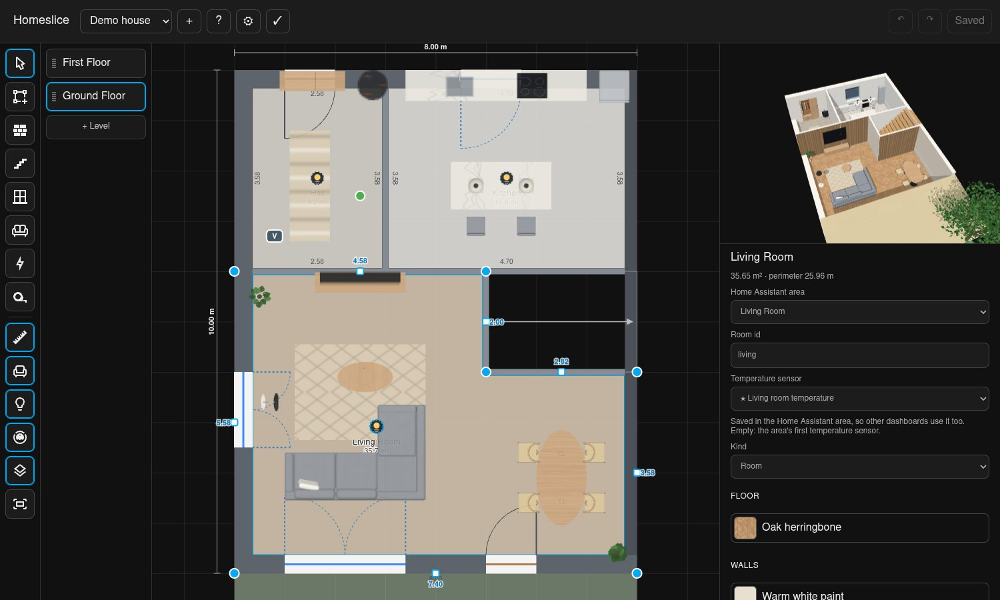

# The Homeslice editor

The editor is an admin sidebar page in Home Assistant (*Homeslice*). There is no drawing
program to learn and nothing to export from another tool: no SVG to draw elsewhere, no 3D
model from Blender. You draw the house over your floor plan, with snapping walls, a wall
view for exact placing, and a live 3D preview.

- [Start a house](#start-a-house)
- [1. Rooms & walls](#1-rooms--walls)
- [2. Doors & windows](#2-doors--windows)
- [3. Objects & entities](#3-objects--entities)
- [Keyboard shortcuts](#keyboard-shortcuts)
- [Furniture library](#furniture-library)
- [Backup, YAML and restore](#backup-yaml-and-restore)
- [Imports](#imports)

## Start a house

Open **Homeslice** in the sidebar and create a house: pick its floors, give rough outside
dimensions, and each floor starts with a placeholder room per area. Levels are your Home
Assistant floors, rooms are your HA areas, and their lights, blinds, sensors and devices
are found by themselves. Rename an area in HA and the house follows; nothing to keep in
sync by hand.

What the editor covers: rooms traced over a floor plan image (straightened and scaled with
a ruler), walls and corners dragged with snapping, doors and windows with their blinds,
stairs, furniture, lights, cameras, energy devices, [robots](robots.md), roof levels,
curved walls; your own pieces from simple shapes (`pieces:`); duplicate floors, move rooms
and pieces between floors, pieces only there while a helper is on; undo/redo; the whole
house as YAML in and out; backup and restore.

Save with `Ctrl+S`. Cards update at once. Can't find something? `Ctrl+K` (or the magnifier in
the header) searches every tool, setting, floor and room.
New to it? The first time, the editor offers a short guided tour: six things to do (pick a
floor, draw a room, reshape it, a door or window, furniture, save), each ticked off when done.
`?` restarts it.

## 1. Rooms & walls

Drag rooms into shape, or upload the floor plan (level inspector), set its scale with two
points of a known length, and draw rooms over it (`R`). A floor can have a few images under
it (the floor plan, a robot vacuum's map, true to scale): switch between them with `N`.
Outside walls of the floors below and above show dashed; dragging snaps to them, and an
outside wall in line with the floor below or above moves on both (Shift: this floor only). Walls appear by themselves; a wall
between two rooms can be dragged on its own or switched to *open* (e.g. an open kitchen).
Stairs: `S`.

The rooms button holds more:

| Tool | Key | What it does |
| --- | --- | --- |
| Room | `R` | Draw a room |
| Wall | `W` | A free-standing wall |
| Railing | `G` | Galleries and stair edges |
| Balcony | `B` | A balcony or terrace |
| Divider | `X` | A line across a room makes two rooms with no wall between (e.g. kitchen and dining area) |
| Assign | `A` | Drag a Home Assistant area onto a room, or into a shape your walls close off, which becomes a room; it lights up before you let go |

Walls that close a shape make it a room at once (cut out of the room they stand in, or a
hole in it when wholly inside, like a closet; its panel offers *Same room as …* when Home
Assistant counts it as part of that room). Rooms without an area say **Unassigned room!**,
with a button that opens the assign tool.

A room drawn over others takes its space from them (the walls along its sides are the ones
already there, cut at its corners), and a wall drawn along an existing one adds only what is
new, so tracing a plan room by room over the starting rooms just works.

**Roofs.** The roof is a level of its own: **+ Roof** under the floors, then presets, more
parts and solar panels. Roof parts can have any angle, roofs can start a floor lower (walls
cut along them), with coverings, dormers, roof terraces (an outdoor room under the slope,
the roof cut away above it), roof windows with shutters and solar panels on the slope.

**Finishes.** Select a room to give its floor and walls a finish (wood, tiles, stone,
paint, acoustic panels, brick…), one wall a different one, and the outline for the facade.
Besides the built-in finishes, the picker offers Poly Haven's photo textures (CC0), which
Home Assistant downloads once when you pick one.

## 2. Doors & windows

Click a wall to add a window, link its blind and contact. Doors, windows and stairs share
one toolbar button (`D`, `S`).

## 3. Objects & entities

Lights are placed automatically and can be dragged. Drag furniture from the
[library](#furniture-library) (wall pieces go against a wall; `R` to turn). Place solar,
battery, grid and power-measured devices for the energy overlay (`E`), and robot vacuums
and mowers (`O`, see [robots](robots.md)).

## Keyboard shortcuts

Press `?` in the editor for this overview.

| Key | Action |
| --- | --- |
| `V` | Select and drag |
| `R` | Draw a room (objects mode: turn the selected furniture, Shift: the other way) |
| `S` | Draw stairs |
| `W` | Draw a free-standing wall |
| `G`, `B`, `X`, `A` | Railing, balcony, divider, assign |
| `M` | Measure |
| `C` | Section: drag a line across the house; the card gets a button that shows the house cut there |
| `D` | Doors & windows |
| `F` | Furniture |
| `E`, `O` | Energy, robots |
| `Ctrl+D` | Duplicate the selected furniture |
| `Del` | Delete what is selected |
| `N` | The next image under the floor |
| `Ctrl+K` | Search: any tool, setting, floor or room by name ("balcony", "fence", "roof", "kitchen") |
| `Esc` | Cancel, deselect |
| `Ctrl+Z` / `Ctrl+Shift+Z` | Undo / redo |
| `Ctrl+S` | Save |
| `Alt` | Hold while dragging: no snapping |
| `Shift` | Hold while dragging an outside wall or corner: this floor only |
| `← ↑ → ↓` | Nudge stairs or energy items (Shift: 50 cm) |
| Double-click | On a wall: add a corner; on a corner: remove it |
| Wheel / drag the background | Zoom / pan the plan |
| `?` | The shortcut overview |

## Furniture library

400+ pieces drawn to their size, with nothing to download. Sofas get more seats as they
get wider, kitchens more units, wardrobes more doors — in your finishes, and they react:
screens show what plays, fans turn, radiators glow, cars come and go.

The library has four sources:

- **Built-in:** pieces drawn by Homeslice to their size, with a finish and often a second
  colour: sofas, wardrobes, kitchens, bathroom, lamps, plants, garden, play, cars and
  bikes… Every built-in piece is drawn in code by Homeslice (MIT); a card loads that code
  only when its house shows detailed furniture.
- **Poly Haven:** realistic models, downloaded into Home Assistant once when placed.
- **Sketchfab:** with your own account (see below).
- **Custom:** upload your own `.glb`. It has to be self-contained: models that load
  textures or data from other websites are refused, so no screen showing your house
  contacts a stranger.

### Poly Haven

The Poly Haven library uses the [Poly Haven](https://polyhaven.com) API; its models are
CC0. Home Assistant downloads a model (1k textures) into `<config>/.cache/homeslice/` the
first time a house uses it, and every device loads it from there. Home Assistant's backups
leave that folder out: the models come back by themselves after a restore. Homeslice is not made or
endorsed by Poly Haven.

### Sketchfab

Sketchfab works with your own account: paste your API token
([sketchfab.com/settings/password](https://sketchfab.com/settings/password)) into the
editor's Sketchfab tab. Home Assistant keeps it (like any integration's credentials, in its
`.storage` folder, in its own encrypted backups, never in Homeslice's export) and sends it
only to Sketchfab's API; browsers never see it. Search finds what your account may
download: free models of any licence (a home is personal use, so non-commercial ones are
fine too) and the ones you bought. A model is downloaded once into Home Assistant, checked
like an upload, and keeps its author and licence, shown with the piece. Exports are never
held back, but a backup or 3D export says which models in it are for your own use only
(bought ones) and which need their author's credit when shared. Homeslice is not made or
endorsed by Sketchfab.

### Clean-up of downloads

Downloads clean up after themselves: Poly Haven models and textures and Sketchfab models
that no house has used for a week are removed (Poly Haven ones come back by themselves if
used again). Your own uploads stay until you delete them in the library.

Sketchfab models and uploads are kept light: the pictures inside them are scaled down to
1024 px (a 4K texture on a chair is never seen on a floor plan), and a model with more than
50,000 triangles is simplified to about that many (nearby points merged, texture seams kept),
so a wall tablet can draw a whole furnished house. That keeps Home Assistant's backups and
the tablets' downloads light too. Models kept before this are made light once, by themselves.

## Backup, YAML and restore

- Editor → ⚙ → *Download* saves the house as YAML. A house saved by one version opens in
  every later one, but a copy of your own is always a good idea.
- Paste a house in the editor's *House settings* (*Replace the house with this YAML*); the
  [house format](yaml.md) describes it.
- Every save keeps the previous version: editor → ⚙ → *Restore the version from …*.
- Backup and restore of the whole house, and a 3D export.

## Imports

Editor → ⚙ → *Import*:

- **From Sweet Home 3D (.sh3d):** rooms, doors, windows and furniture come in as YAML to
  check before using it.
- **Plan from another 3D floor-plan card (.json):** its plan export or backup (or its
  `.storage` file, or its simple hand-written plan format) comes in with floors, rooms and
  their areas, open-plan walls, doors and windows with their blinds, contacts and locks,
  furniture, lamps, cameras and stairs; what has no place yet is listed.
- **Floor plan drawing (.svg)**, e.g. from an SVG floor-plan card: closed shapes become
  rooms (named by their label or id), and elements whose id or class names an entity
  (`light.kitchen`) become that light or device in the room under them. You say how wide
  the drawing is in reality.

To let an AI assistant draw the house instead, see [AI assistants](llm.md).
